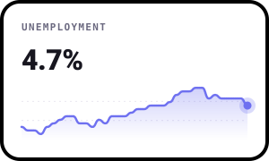
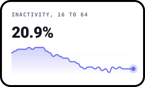
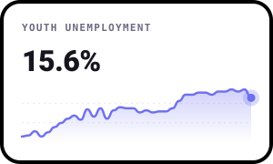
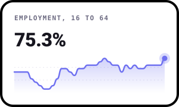
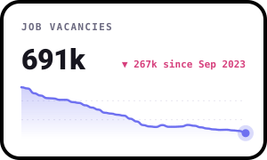
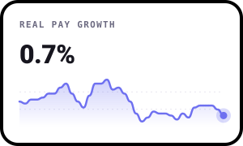

# Jobs & the Economy

**A free, friendly UK data challenge about work: who has it, who's looking, who's stepped away, and whether pay is keeping up.**

Jobs touch everything. When work is easy to find, pay tends to rise and people spend more. When it dries up,
families feel it first, then the whole economy does. Behind the headline unemployment rate there's a much bigger
story: millions of people who aren't working or looking, young people finding it harder to get a start, and pay
that spent years falling behind prices.

This project does two things:

1. **It answers questions.** The [State of UK jobs](findings/README.md) report has eight findings, each with a
   chart and a plain-English explanation. It redraws itself every time the ONS publishes new figures.
2. **It asks you questions.** Each month there's a new challenge. Dig into the data, make something and share it.
   No sign-up and no gatekeeping. Beginners are very welcome.

---

## Right now








*The latest figures, with the last three years behind them. Updated automatically from the ONS.*

**[Read the full State of UK jobs report →](findings/README.md)**

| # | Finding | |
|---|---|---|
| 1 | The headline numbers | Unemployment, employment, inactivity, vacancies and pay at a glance |
| 2 | Unemployment since 1971 | Every big downturn, from the 1980s to Covid |
| 3 | Jobs for each unemployed person | How tight the jobs market is, and the 2022 record |
| 4 | Why people are out of work and not looking | The rise of long-term sickness |
| 5 | Is pay beating prices? | Real pay since 2001, and the long squeeze after 2008 |
| 6 | Where in the UK | Unemployment by nation and region |
| 7 | Young people | How 16 to 24 year olds are doing compared with everyone else |
| 8 | Low unemployment, faster pay rises? | The Phillips curve, tested on UK data since 2001 |
| + | Can we trust the numbers? | What happens when the survey and the payroll records disagree |

---

## This month

### December 2026: Where did the workers go?

**The question:** Why are millions of working-age people out of work and not looking, and what's changed?

More than 9 million people aged 16 to 64 aren't working or looking for work. For decades that number fell as more
women went out to work. Now long-term sickness is the biggest single reason, up by hundreds of thousands since Covid.


**Runs:** 1 to 31 December 2026
**Full brief:** [challenges/2026-12-where-did-the-workers-go](challenges/2026-12-where-did-the-workers-go/README.md)

| Level | What you'll do |
|---|---|
| 🟢 Beginner | Chart one reason for being inactive and spot when it changed |
| 🟡 Intermediate | Compare the reasons. Which grew, which shrank, and how do they behave in a recession? |
| 🔴 Expert | Bring in age, health or local data and test an idea |

---

## How it works

1. **Read the brief** for this month in the [`challenges`](challenges/) folder.
2. **Get the data.** It's already in this repo in [`data/labour_market.csv`](data/labour_market.csv). Run
   `python data/fetch.py` to download the very latest straight from the ONS.
3. **Make something.** Python, R, Excel, Tableau, pen and paper scanned in: anything goes.
4. **Share it.** Fork this repo, add a folder at `submissions/2026-12/your-github-username/` with a short
   `README.md` (use the [template](SUBMISSION_TEMPLATE.md)), then open a pull request.

New to GitHub? [CONTRIBUTING.md](CONTRIBUTING.md) walks you through it step by step.

### Run it yourself

```bash
git clone https://github.com/ShazMoghaddam/uk-jobs-economy.git
cd uk-jobs-economy
pip3 install -r requirements.txt
python3 data/fetch.py        # download the latest figures from the ONS
python3 findings/build.py    # redraw every chart and rewrite the report
```

Every chart is drawn with [bezel-charts](https://pypi.org/project/bezel-charts/), a small open-source Python
library that turns pandas data into clean SVG charts.

---

## What's coming up

Each month takes one part of the jobs market and goes deeper.

| Month | Question | Extra data |
|---|---|---|
| **Dec 2026** | **Where did the workers go?** The rise of economic inactivity | Inactivity by reason |
| Jan 2027 | **A harder start?** How young people are doing in the jobs market | Unemployment by age |
| Feb 2027 | **Is pay beating prices?** Real pay, and who has fallen behind | Average weekly earnings |
| Mar 2027 | **It depends where you live.** Jobs across the UK's nations and regions | Regional labour market data |
| Apr 2027 | **Can we trust the numbers?** The survey against the payroll records | HMRC PAYE Real Time Information |

The order may change. Vote in [Discussions](https://github.com/ShazMoghaddam/uk-jobs-economy/discussions) or
[suggest an idea](https://github.com/ShazMoghaddam/uk-jobs-economy/issues/new?template=idea-suggestion.yml).

Working on house prices too? The sister project, [House Prices & the Economy](https://github.com/ShazMoghaddam/uk-house-prices-economy),
looks at how prices move with jobs, pay and interest rates.

---

## Key ideas in plain English

| Word | What it means |
|---|---|
| **Employed** | Doing paid work, even for just an hour a week |
| **Unemployed** | Not working, but looking for work and able to start soon |
| **Unemployment rate** | Unemployed people as a share of everyone working or looking for work |
| **Economically inactive** | Not working and not looking. For example students, carers, people who are long-term sick and early retirees |
| **Vacancy** | A job that an employer is trying to fill |
| **Tight labour market** | Lots of vacancies for each unemployed person. Easier to find work, harder to hire |
| **Real pay** | Pay growth with rising prices taken off. If pay rises 5% and prices rise 6%, real pay falls 1% |
| **Recession** | When the economy shrinks for a while. Businesses earn less and some people lose jobs |
| **Labour Force Survey** | The big ONS survey of households that most of these figures come from |
| **PAYE payroll data** | Counts of people paid through employers' payrolls, from HMRC tax records |
| **"3-month average"** | Survey figures are averaged over three months to smooth out the bumps. "Jun to Aug" is one figure |
| **Percentage points** | The gap between two percentages. Going from 4% to 5% is up 1 point, even though it's a 25% rise |

---

## Gallery

The best entries each month are featured here.

### December 2026
*Be the first. Submissions open 1 December.*

---

## Join the conversation

Head to [Discussions](https://github.com/ShazMoghaddam/uk-jobs-economy/discussions) to share early findings, ask
questions, give feedback on other people's work and vote on what comes next.

---

## Data and licences

All data comes from the Office for National Statistics and HMRC under the
[Open Government Licence v3.0](https://www.nationalarchives.gov.uk/doc/open-government-licence/version/3/).
[`data/sources.json`](data/sources.json) lists every series with its ONS ID, link and release date.

Code and content in this repo are [MIT licensed](LICENSE). By submitting a pull request you agree to share your
entry under the same licence.

---

Created by **Shaz Moghaddam** · London
[Website](https://shazmoghaddam.github.io) · [LinkedIn](https://www.linkedin.com/in/shazmoghaddam)
