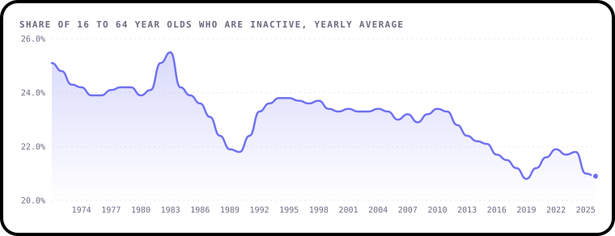
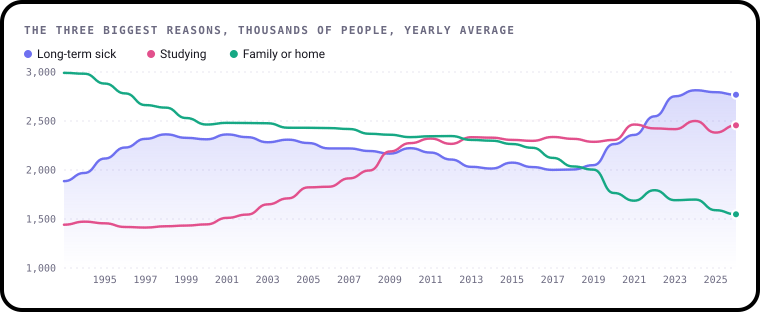

# December 2026: Where did the workers go?

**The question:** Why are millions of working-age people out of work and not looking, and what's changed?

**Runs:** 1 to 31 December 2026
**Data:** ONS Labour market overview, October 2026 release (figures for June to August 2026). It's already in this repo.

---

## The story so far

Most people know about **unemployment**: people without a job who are looking for one. But there's a much bigger
group that gets less attention. In June to August 2026, **9.09 million** people aged 16 to 64 were
**economically inactive**: not working and not looking for work.

For fifty years that group got smaller, mostly because more women went out to work. In 1971 a quarter of 16 to
64 year olds were inactive. Just before Covid the share hit a record low of **20.3%**. Since then it has crept back up.



Lots of inactive people have good reasons. They're studying, caring for family or have retired early. But look at
what has happened to each reason over time:



- In 1993, **3.02 million** people were inactive because they were looking after family or home. Now it's
  **1.56 million**, about half.
- Over the same time, people who are inactive because of **long-term sickness** went from **1.81 million** to
  **2.74 million**. It overtook looking after family in 2018, then studying in 2021. Since July to September
  2021 it has been the biggest single reason every month.
- It peaked at **2.85 million** in September to November 2023.

Why? Nobody knows for sure, and that's what makes it a good question. Possible reasons people discuss include an
ageing workforce, long NHS waiting lists, more mental health conditions, long Covid and changes to benefits. Your
job is to dig into it.

*Both charts are made from this repo's data by [`make_charts.py`](make_charts.py), with
[bezel-charts](https://pypi.org/project/bezel-charts/).*

---

## Get the data

It's already in this repo, so you don't need to download anything:

**[`data/labour_market.csv`](../../data/labour_market.csv)**: one row per month, one column per figure.

Want the very latest numbers, or to check where they came from? Run `python data/fetch.py`, which downloads
everything from the ONS website. [`data/sources.json`](../../data/sources.json) lists every series with its
official ONS ID and link.

**The columns you'll need this month**

| Column | In plain English |
|---|---|
| `date` | The month, e.g. `2026-07`. Survey figures cover three months centred on it, so `2026-07` means June to August |
| `inactive_000s` | Everyone aged 16 to 64 who is inactive, in thousands |
| `inactivity_rate` | The same, as a share of all 16 to 64 year olds (%) |
| `inactive_long_term_sick_000s` | Inactive because of long-term sickness, thousands |
| `inactive_students_000s` | Inactive because they're studying, thousands |
| `inactive_family_000s` | Inactive because they're looking after family or home, thousands |
| `inactive_retired_000s` | Retired before 65, thousands |
| `inactive_temp_sick_000s` | Inactive because of a short-term illness, thousands |
| `inactive_other_000s` | Any other reason, thousands |

The reasons start in 1993. The overall rate goes back to 1971.

---

## Pick your level

### 🟢 Beginner
Pick one reason for being inactive.
- Chart it over time
- Mark one or two big events, like the 2008 crash or Covid
- In one or two sentences: what changed, and when?

### 🟡 Intermediate
Pick one question:
- Which reasons have grown and which have shrunk since 1993? Show them side by side.
- What share of inactive people were long-term sick in 1993, in 2019 and now?
- Did inactivity rise or fall during each recession? Does it behave like unemployment?
- Studying is up too. Is that a good thing, a sign of a tough jobs market, or both?

### 🔴 Expert
Bring in one more piece of data and test an idea. For example:
- **Age and sex.** ONS publishes inactivity by age group and sex on its
  [economic inactivity pages](https://www.ons.gov.uk/employmentandlabourmarket/peoplenotinwork/economicinactivity).
  Is the rise in long-term sickness concentrated among older workers, or young people too?
- **NHS waiting lists.** Put [NHS England waiting times](https://www.england.nhs.uk/statistics/statistical-work-areas/rtt-waiting-times/)
  next to long-term sickness. Do they move together, and does that prove one causes the other?
- **Places.** [Nomis](https://www.nomisweb.co.uk) has inactivity for local areas. Where is long-term sickness highest?

Explain what you find in plain language. A clear finding beats a complicated model, and saying what your data
can't prove is a strength, not a weakness.

---

## Starter code

A small Python script, [`starter.py`](starter.py), gets you going. From the top of the repo, in Terminal on a Mac:

```bash
pip3 install -r requirements.txt
python3 challenges/2026-12-where-did-the-workers-go/starter.py
```

It prints a quick summary and saves two charts as SVG files, which open in any browser:

```
Figures from Apr 1993 to Jul 2026 (thousands of people aged 16 to 64)
Long-term sick now:      2,738,000
Long-term sick in 1993:  1,813,000
Highest:                 2,850,000 in Oct 2023
Saved long-term-sick.svg and reasons-now.svg. Open them in your browser.
```

The charts are drawn with [bezel-charts](https://pypi.org/project/bezel-charts/), but use whatever you like:
matplotlib, Excel, Tableau or pen and paper all work.

---

## Share your work

Put your work in `submissions/2026-12/your-github-username/` with a `README.md` based on the
[submission template](../../SUBMISSION_TEMPLATE.md), then open a pull request. [CONTRIBUTING.md](../../CONTRIBUTING.md)
has step-by-step help.

Credit the data like this:

> Source: Office for National Statistics licensed under the Open Government Licence v3.0.

---

Created by **Shaz Moghaddam** · London
[Website](https://shazmoghaddam.github.io) · [LinkedIn](https://www.linkedin.com/in/shazmoghaddam)
