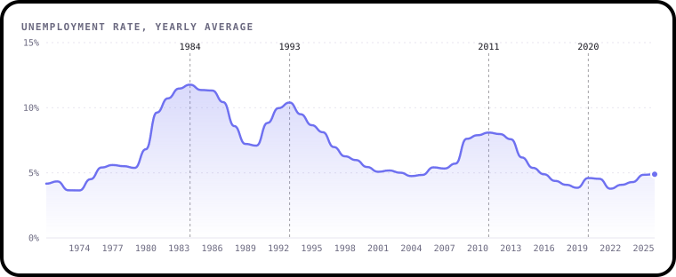
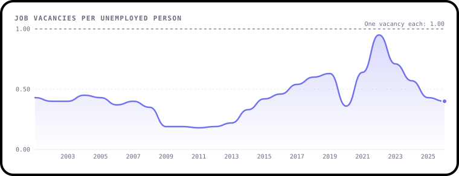
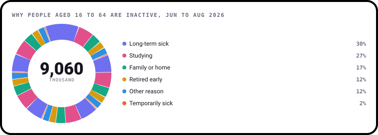
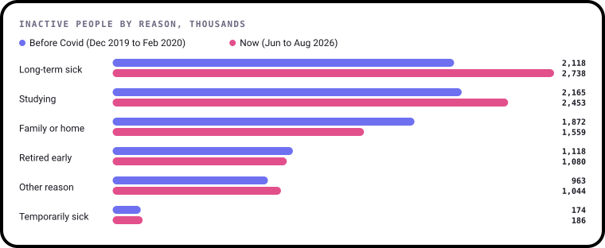
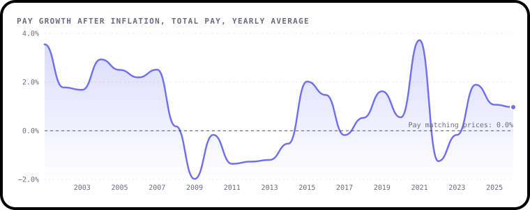
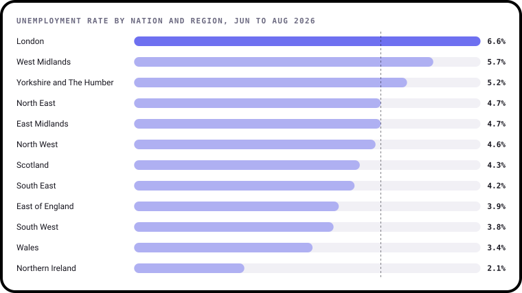
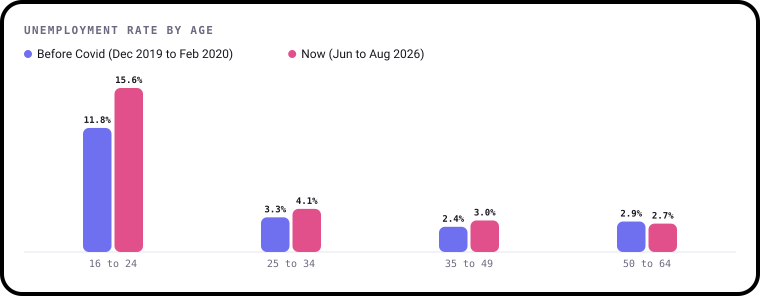
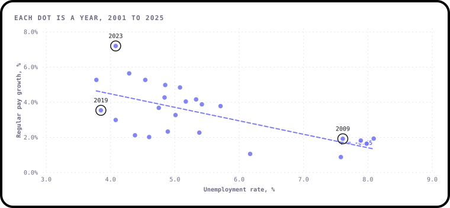
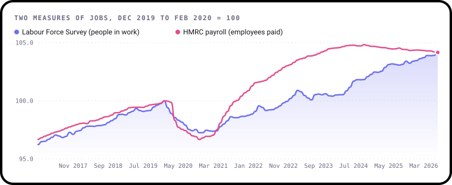

# State of UK jobs

**Latest data: Jun to Aug 2026.** Every number and chart on this page is worked out from ONS data by
[`build.py`](build.py), and redrawn automatically when ONS publishes new figures. Charts are drawn with [bezel-charts](https://pypi.org/project/bezel-charts/), an open-source Python library created by Shaz Moghaddam, the author of this project.

Data last downloaded: 2026-10-31 13:20 UTC.

## 1. The headline numbers

  
  
  

  
  
  

Each tile shows the last three years. The big number is the latest figure.

- **4.7%** of people who are working or looking for work are unemployed. That's
  down 0.1 points on a year earlier.
- **691,000** jobs were waiting to be filled in Jul to Sep 2026, against
  **1.71 million** unemployed people.
- Pay rose **3.7%** on a year earlier, in Jun to Aug 2026. After rising prices are taken
  off, that's **0.7%**.

## 2. Unemployment since 1971

Unemployment has risen sharply in every big downturn, then taken years to come back down.

- **The early 1980s** were the worst: unemployment peaked at **11.9%** in Feb to Apr 1984, as factories and mines closed.
- **The early 1990s** recession pushed it to **10.7%** in Dec 1992 to Feb 1993.
- **After the 2008 financial crisis** it rose more slowly but stayed high for years, reaching **8.5%** in Sep to Nov 2011.
- **Covid** was a much smaller bump than many feared, peaking at **5.3%** in Oct to Dec 2020.
  Government furlough paid wages for millions of people, so most kept their jobs.

More recently it climbed to **5.2%** in Oct to Dec 2025, and was 4.7% in Jun to Aug 2026.

The lowest rate on record was **3.4%**, in Oct to Dec 1973.

## 3. How many jobs are there for each unemployed person?

When there are lots of vacancies for each unemployed person, it's easier to find work and employers have
to compete for staff, often by paying more. Economists call this a **tight** labour market.

- Right now there are **0.41** vacancies for every unemployed person, against **0.59** just before Covid.
- In Apr 2022 vacancies outnumbered unemployed people for the first time since the figures began in
  2001. The ratio peaked at **1.02** in Jul 2022.
- At the low point, in Oct 2011, there were only **0.17**: about one vacancy for every
  6 unemployed people.

## 4. Why are people out of work and not looking?

**Economically inactive** means not working and not looking for work. In Jun to Aug 2026,
**9.09 million** people aged 16 to 64 were inactive. Many have good reasons: they're studying,
caring for family or have retired early.

The biggest group, though, is people who are **long-term sick**: **2.74 million**, or about 30% of everyone
inactive for a stated reason.

- Long-term sickness is up **620,000** since just before Covid.
- When these figures began, in Mar to May 1993, the number was 1.81 million. It peaked at
  **2.85 million** in Sep to Nov 2023.
- Among the other reasons, studying is up 288,000, family or home is down 313,000, retired early is down 38,000.

This matters for the whole economy. Fewer people working means fewer people paying tax and more pressure on
benefits and the NHS.

## 5. Is pay beating prices?

**Real pay** is pay growth with rising prices taken off. If your pay rises 5% but prices rise 6%, your real pay
has fallen 1%.

- Right now real pay is growing **0.7%** a year, in the three months to Aug 2026.
- The worst point was **-5.5%** in the three months to Mar 2009, during the financial crisis.
- Since 2001, real pay was falling in **99** of the monthly figures.
  The longest unbroken run of falls lasted from May 2010 to Feb 2014.
- The 2021 jump is partly a quirk: pay was being compared with 2020, when many furloughed workers were on reduced pay.
- In 2022 and early 2023 pay rose fast, but prices rose even faster, so most people were still worse off.

## 6. Which places are doing best and worst?

In Jun to Aug 2026, unemployment was highest in **London (6.6%)** and lowest in
**Northern Ireland (2.1%)**. The UK average was 4.7%, shown by the line.

London surprises many people. It has lots of well-paid jobs, but also many people looking for work, high living
costs and a young, fast-moving population, so its rate is often above average.

These regional figures come from smaller samples, so they jump around more from month to month. Look at the
trend over several months before reading too much into one figure.

## 7. How are young people doing?

Young people always have higher unemployment: they're new to work, change jobs more and are often the first
to go when firms cut back. But the gap has grown since Covid.

- Among 16 to 24 year olds who are working or looking for work, **15.6%** are unemployed, against
  **11.8%** just before Covid.
- For older age groups the rate is between 2.7% and 4.1%.
- Youth unemployment is up 1.0 points on a year earlier.
  The last time it was this high was Apr to Jun 2015.

## 8. Do low unemployment and fast pay rises go together?

Economists have long noticed that when unemployment is low, pay tends to rise faster, because employers have to
compete for workers. This is called the **Phillips curve**, after the economist Bill Phillips, who spotted it in UK
data in 1958.

Each dot is a year from 2001 to 2025. The dashed line is the best straight-line fit, and
**r = -0.65** measures how closely the dots follow it (−1 would be a perfect downward line, 0 no pattern at all).

- The pattern is real but loose. Years after the 2008 crash sit bottom right: high unemployment, slow pay growth.
- 2022 to 2024 sit top left, but low unemployment wasn't the only reason. Prices were rising fast, and people
  pushed for pay rises to keep up.

## Can we trust the numbers?

Most of the figures above come from the **Labour Force Survey**, which asks a sample of households about work.
In 2023 so few people were answering it that ONS paused some of its figures for a while. Responses have since
recovered, but ONS still warns that some figures, especially smaller breakdowns like regions, jump around more
than they used to. It has also said survey changes made since 2024 may be making recent employment growth look
stronger than it really is. ONS is moving to a new online version, the Transformed Labour Force Survey.

There's a second source. **HMRC payroll records** count everyone paid through PAYE, so they're based on real pay
slips, not answers to a survey. They miss self-employed people, but they're a useful check.

- Since just before Covid, the survey says the number of people in work rose by **1.40 million**,
  to Jul 2026.
- Payroll records peaked at **30.46 million** employees in Oct 2024. By Sep 2026
  the figure was 181,000 lower.
- So the two sources have been pointing in different directions. The truth is probably somewhere in between, and
  that's a good reminder to check more than one source before drawing big conclusions.

The latest payroll month is a first estimate and often changes.

---

**Sources:** Office for National Statistics, Labour market overview and Average weekly earnings, and HMRC PAYE Real
Time Information, all under the [Open Government Licence v3.0](https://www.nationalarchives.gov.uk/doc/open-government-licence/version/3/).
Series IDs and links are in [`data/sources.json`](../data/sources.json).
